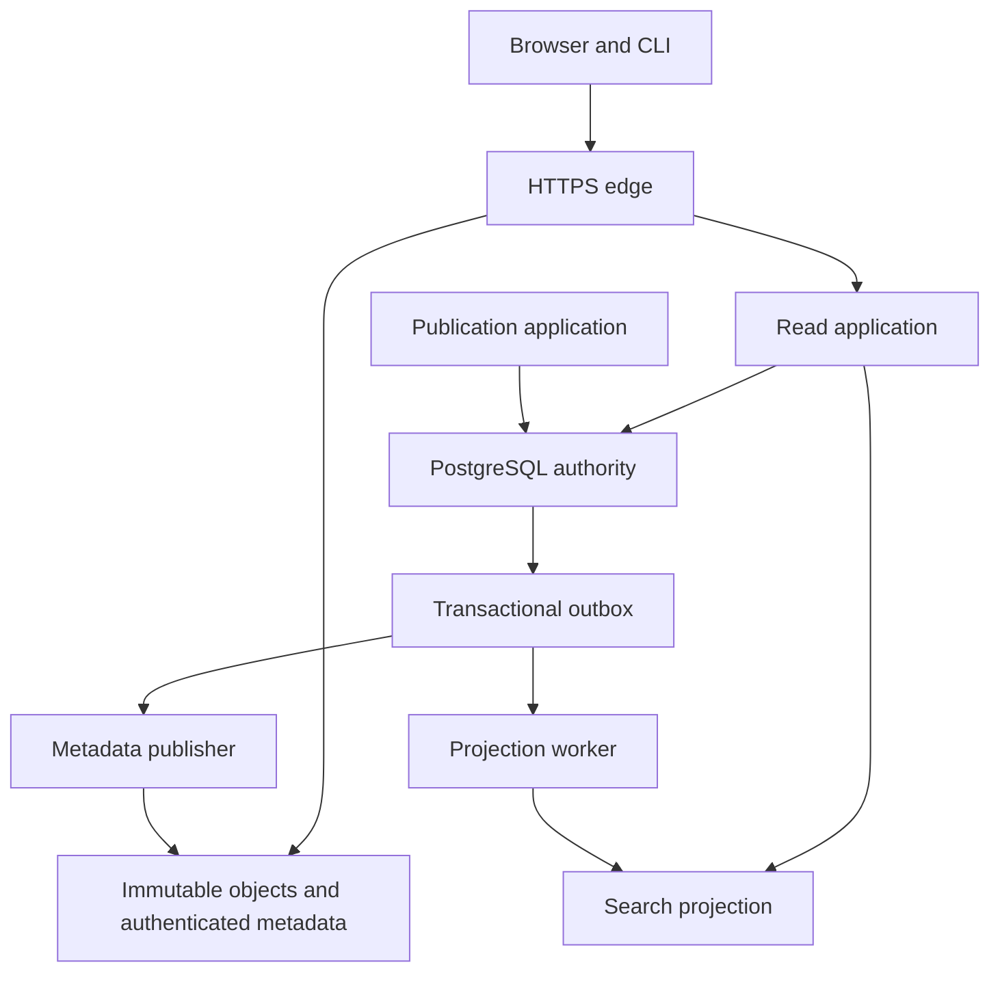

# Architecture for global software distribution

**Status: proposal. Reviewed against the implementation and primary references on 1 November 2026.**

ASM should support substantial discovery traffic and reliable software distribution from the outset.
Search is a core product capability with its own capacity, relevance, and availability requirements.
Installation must remain dependable when search is slow or unavailable.

The application server should use assembly for application logic.
Mature libraries should handle HTTP framing, TLS, cryptography, and the PostgreSQL protocol.
The browser should receive useful HTML, with selective HTMX enhancements.
The frozen, unpublished Rust service remains a behavioral reference during this work.

This document defines proposed contracts and implementation gates.
Its workloads and service objectives are design targets, not measured capabilities.
Available infrastructure, operating budget, traffic, staffing, and regional requirements remain unverified.
The [gap and acceptance table](architecture-gates.md) distinguishes current behavior from required changes.

## 1. Distinguish the deployed alpha, local experiments, and proposal

### Deployed public alpha

The public `asm.build` site uses static GitHub Pages and a generated v1 registry.
The [Pages workflow](../.github/workflows/pages.yml) builds and publishes that static site.
The [browser code](../site/app.js) downloads the JSON catalog and filters package names, summaries, and targets locally.
The [native registry client](../cli/registry.s) reads the whole active TSV catalog.

The TSV permits at most 4,096 artifact rows and 1 MiB.
Both its generator and native reader enforce those bounds.
The [registry validator](../tools/registry.py) permits GitHub release URLs and artifacts up to 64 MiB.

These are compatibility alpha limits.
They are not the future distribution protocol or a scalable search endpoint.
Increasing the TSV limit would preserve its whole-catalog download cost.
Replacing JSON with another encoding would not remove that cost.

The alpha package index also lacks an independent signature, expiry, and rollback protection.
HTTPS and artifact hashes do not establish package ownership by themselves.
The [security specification](specs/security.md) already records this limitation.

### Local server experiments

Two local server experiments inform this proposal.
The [assembly server experiment](../experiments/assembly-server/README.md) is a published source reference for local HTTP and PostgreSQL tests.
The Rust behavioral reference remains unpublished.
Neither server is deployed at `asm.build`.

A local Rust behavioral reference exercises metadata transactions, publication seals, scoped database roles, and bounded HTTP behavior.
Its search uses literal `strpos` predicates over authoritative package names and release summaries.
It selects an eligible release through a lateral query and orders results by package name.
It has no full-text index or separate search projection.

Its response limit bounds returned rows.
It does not bound rows examined, database work, or discovery capacity.
The published assembly experiment exercises a narrower HTTP and PostgreSQL boundary with mature protocol libraries.
It does not establish full reference parity, public TLS, HTML delivery, or indexed production search.

These local tests inform proposed contracts, not public feature or performance claims.
Source, test records, and implementation limits need review before either experiment can support promotion.
The remaining sections describe the proposed architecture and its acceptance gates.

## 2. Separate three responsibilities

An immutable object is a file whose published bytes never change.
A projection is a derived view that can be rebuilt from authoritative records.
An outbox is a durable event record committed with the state change that produced it.

| Responsibility | Authority and purpose | Failure effect |
| --- | --- | --- |
| Artifact and metadata delivery | Immutable objects, authenticated metadata, CDN caches, and mirrors | Controls whether a client can obtain and verify selected software |
| Ownership and publication | PostgreSQL transactions, identity, authorization, version records, and audit events | Controls new publication and ownership changes |
| Discovery | A rebuildable search projection and browser views | Controls finding software, not whether a known artifact is authentic |

These responsibilities do not require a separate service for every table or endpoint.
Begin with a small assembly application and explicit process modes.
Give public reads, publication operations, projection work, signing, and untrusted checks separate credentials and resource budgets.

The diagram shows data relationships, not a required deployment topology.
Isolated artifact checks report to the publication state machine.
They receive neither production database credentials nor signing keys.

## 3. Choose protocols by workload

HTTP, gRPC, GraphQL, and REST describe different layers or interface choices.
GraphQL commonly uses HTTP and does not require a particular transport.
Its query language controls requested data, not the underlying database index.
[The GraphQL HTTP guidance](https://graphql.org/learn/serving-over-http/) explains this separation.

### Default public interfaces

Use HTTPS resource and task APIs for the native client, automation, and external integrations.
Use JSON for structured control messages and ordinary HTTP transfers for artifact bytes.
Publish a machine-checked OpenAPI contract with explicit schemas, bounds, examples, and error cases.
[OpenAPI](https://spec.openapis.org/oas/v3.2.1.html) describes HTTP interfaces independently of the implementation language.

Use GET for public resources with explicit cache rules.
Use durable task resources for long publication operations.
Use bounded batch operations where measured client round trips justify them.
The API design must permit HTTP/2 or HTTP/3 at the edge without changing resource semantics.

The proposed stable contract needs these resource families:

| Resource | Contract |
| --- | --- |
| `/api/v2/capabilities` | Protocol versions, supported limits, target schema, and consistency modes |
| `/api/v2/packages/{owner}/{name}` | Exact package identity and current public state |
| `/api/v2/packages/{owner}/{name}/versions` | Bounded version pages with version-specific licenses |
| `/api/v2/search` | Bounded discovery queries, facets, cursors, and freshness metadata |
| `/api/v2/publications` | Authenticated creation of an idempotent publication task |
| `/api/v2/publications/{id}` | Durable progress, failures, recovery actions, and final release links |
| `/registry/v2/...` | Authenticated package catalogs, manifests, and policy metadata |
| `/blobs/sha256/{digest}` | Immutable artifact bytes |

These are proposed paths, not claims about deployed endpoints.
The unpublished reference's `/api/v2` routes are experimental.
Freeze the stable schema before clients depend on that version.
Catalog API responses provide discovery and status information.
Installation authority comes from authenticated registry metadata and current lifecycle policy.

Identifiers must not lose precision in JavaScript clients.
Encode opaque IDs, provider account IDs, and revision counters as strings in JSON.
Reject duplicate fields, invalid encodings, unsupported parameters, and ambiguous identifiers.
Keep package names distinct from immutable package and owner IDs.

Use consistent machine-readable errors based on [RFC 9457](https://www.rfc-editor.org/rfc/rfc9457.html).
Each error needs a stable code, a useful recovery action, and the relevant retry policy.
Use `429` with bounded retry guidance for admission limits.
Use `503` for temporary dependency failures, not a false empty result.
Use `410` when a search snapshot expires.

Every mutating request needs an idempotency key scoped to its principal and operation.
Retain its payload digest and result for a documented interval.
Reject reuse with different content.
Workers must also use idempotent operations; an HTTP retry policy cannot provide exactly-once side effects.

### Where gRPC can help

gRPC provides typed service definitions, generated bindings, and unary or streaming calls.
Those features can help a controlled worker fleet.
[The gRPC documentation](https://grpc.io/docs/what-is-grpc/core-concepts/) defines these capabilities.

Introduce it when worker deadlines, cancellation, streaming, or generated interfaces justify an additional protocol.
Retain durable jobs, leases, authorization, and replay rules underneath it.
Do not require gRPC for cacheable public metadata or blob transfers.
Do not assume a protocol change will improve a database-bound query.

### Where GraphQL can help

A read facade could help applications that repeatedly compose many related catalog views.
Add it only after that burden is measured.
It would call the same authorized domain operations and search backend.

GraphQL can use GET requests and cached persisted operations.
It is not inherently uncacheable.
However, an open query interface needs explicit depth, breadth, pagination, and cost limits.
[GraphQL's security guidance](https://graphql.org/learn/security/) discusses these controls.

Keep it outside the initial critical installation and publication paths.
A typed resource API already provides a stable contract for those tasks.

### HTML and selective HTMX

Search, filtering, package inspection, pagination, and task status must work through ordinary links and forms.
The server renders the complete page without optional JavaScript.
HTMX can replace result regions and refresh progress while preserving the same URLs and actions.
[HTMX](https://htmx.org/docs/) supports HTML responses and progressive enhancement.

Use explicit fragment URLs or correct `Vary` handling for full-page and fragment responses.
Give each representation its own validator.
Never let a shared cache return a fragment as a complete page.

Use server-side escaping, a restrictive content policy, and a pinned, locally served HTMX asset.
Use normal form validation and accessible error summaries.
Keep focus, browser history, keyboard navigation, and manual refresh usable.
Publication sessions need CSRF protection and secure cookies.
Private task pages must not enter shared caches.

The ASM interface can work without its enhancement script.
An external identity provider can have separate browser requirements.
Those requirements must remain visible to the user.

## 4. Make distribution independent of the catalog size

An exact install must fetch only the trust metadata, package records, dependencies, and artifacts it needs.
It must not search the catalog or download every package record.
Dependency resolution uses authoritative, authenticated package catalogs, not search rankings.

### Immutable content-addressed objects

Store each verified artifact under an algorithm-qualified digest key.
For example, `blobs/sha256/ab...` identifies exact bytes, not a publisher-controlled filename.
Record its byte length, media type, and declared target requirements.
Keep uploaded data private until verification and publication requirements are met.

Stream uploads and hashing with explicit limits.
Use private staging, resumable transfer identifiers, quotas, expiry, and cleanup.
Check the complete object before promoting it into the retained object set.
Recheck authorization before publication, even when upload authorization was valid earlier.

The storage contract requires conditional creation and rejects replacement of an existing digest key.
Verify those semantics on the selected provider.
[Amazon S3 conditional writes](https://docs.aws.amazon.com/AmazonS3/latest/userguide/conditional-writes.html) illustrate one implementation.
An S3-compatible interface alone does not prove equivalent durability or overwrite behavior.

Serve retained objects through a CDN and optional mirrors.
Support bounded range requests and resumable downloads.
The client verifies expected length and digest before installation.
A mirror supplies bytes; it does not gain package ownership or signing authority.

Use long-lived caching for immutable digest URLs.
Use short, explicit freshness rules for changing metadata heads.
[RFC 9111](https://www.rfc-editor.org/rfc/rfc9111) defines HTTP cache behavior.
[RFC 8246](https://www.rfc-editor.org/rfc/rfc8246.html) defines the immutable response extension.

Do not treat an object-store ETag as the package's cryptographic digest.
Keep artifact origins separate from authenticated browser sessions.
Serve arbitrary package bytes as downloads with appropriate content types and `nosniff`.
Preserve referenced objects during garbage collection, rollback, and index rebuilds.

A revoked artifact can remain cached or mirrored.
Revocation changes whether a client may select or install it.
It cannot guarantee deletion of every copy.

Download observations need a separate contract.
Distinguish redirect responses, completed transfers, range responses, and client-reported installations.
Record the source, coverage interval, deduplication rule, and reporting delay for each published counter.
Mirrors without telemetry make total delivery volume unknown.
Missing reports must not become zero downloads.
Do not infer unique users from transfer counts.

### Authenticated package metadata

Define a versioned registry profile around The Update Framework, or TUF.
TUF separates trust roles and checks signatures, metadata versions, expiry, and consistent snapshots.
Root rotation must follow its required chain of trust.
Use a maintained implementation through a reviewed integration boundary.
Do not replace its verification rules with a custom signature check.
[The reviewed specification is TUF 1.0.37](https://theupdateframework.github.io/specification/latest/).

Ship a trusted initial root through the verified client release.
Bind trust state and lock files to a registry identity.
Changing registries must not silently reuse another registry's package identity or root keys.

Authenticate each package catalog and version manifest.
The manifest binds immutable package identity, version, license, source, dependencies, and artifact digests.
Target requirements separate ISA, operating system, ABI, and required CPU features.
Do not infer compatibility from a filename or a broad architecture label.

Separate mutable lifecycle policy from immutable release bytes.
Keep proof, test, advisory, and provenance records bound to exact artifacts and checker identities.
A completed proof applies only to its theorem, model, target, and stated assumptions.
An LLM review cannot grant a safety status.

Use bounded package catalogs and immutable pages for packages with many versions.
Authenticated page references must bind their digest, range, schema, and package identity.
The profile must define duplicate rejection, canonical bytes, and maximum sizes.
TUF metadata keeps TUF's encoding rules unchanged.

TUF also has metadata scaling costs.
A snapshot or delegated role can become large as the catalog grows.
Do not assume one role per package, or a single global snapshot, will satisfy the client budget.

The profile must benchmark standard delegation layouts and package-catalog paging.
Measure root refresh bytes, snapshot size, delegation requests, and cold dependency resolution.
If multiple trust partitions are needed, specify authenticated routing and rotation before deployment.
No client may accept unsigned metadata to bypass a size limit.

Record key custody, signer permissions, rotation procedures, and recovery exercises.
Separate offline root authority from routine publication signers.
Independent key custody is a deployment decision that needs real participants and recovery access.
Several keys controlled by one person do not establish independent governance.

## 5. Keep PostgreSQL authoritative for publication

Retain numeric provider identities and immutable internal account, namespace, package, and release IDs.
Resolve display names through explicit bindings.
Audit ownership transfers, trusted-publisher changes, recovery actions, yanks, and emergency revocations.

Authenticate public publishing through scoped credentials or an explicitly configured OIDC publisher identity.
Use mature token verification with explicit signature algorithms and trusted issuers.
Verify issuer, audience, subject, repository identity, workflow constraints, expiry, and replay protections against the selected provider's contract.
Do not authorize a publisher from a repository display name alone.
[OpenID Connect's validation rules](https://openid.net/specs/openid-connect-core-1_0.html#IDTokenValidation) provide the identity-token baseline.
Workload claims and package authorization require a separate provider-specific policy.

Use one transaction to check current authority, reserve the immutable version, record artifact references, and append the publication event.
Commit its outbox event in that same transaction.
Do not write the database and search engine as two independent request-side operations.

The durable publication states should include:

| State | User-visible meaning |
| --- | --- |
| `accepted` | The durable task exists; no release is visible yet |
| `uploading` | Private artifact transfers can resume within their limits |
| `checking` | Required checks are running; individual results and failures remain visible |
| `committed` | Immutable database records exist; authenticated distribution is pending |
| `distributing` | Metadata publication and required delivery checks are in progress |
| `published` | Required artifacts and authenticated metadata are available; search can still be updating |

Failure and cancellation retain a reason, retry eligibility, and the last completed state.
A failed attempt must not overwrite a published version.
Workers use leases and fencing values so an expired worker cannot finalize a later attempt.
After `committed`, recovery can resume distribution or apply explicit lifecycle policy.
It cannot free the version for different bytes.

Object storage and PostgreSQL do not share one transaction.
Verify durable artifact placement before committing publication intent.
Generate immutable authenticated metadata from that committed intent.
Expose the new metadata head only after its referenced objects exist.
Mark distribution complete after its required delivery checks pass.

Advance mutable metadata heads with fenced compare-and-swap operations.
Bind each head to monotonic authoritative publication and policy revisions.
Reject an older worker's result after a newer revision advances the head.
Ordinary publication must preserve newer critical policy.
Test reversed worker completion, expired leases, failed comparisons, and concurrent revocation.

Reconcile crashes between these steps idempotently.
Metadata already made public remains a retained publication fact.
Recovery must not assign different bytes to the same version.

Return a durable task URL immediately after acceptance.
Show upload, checking, distribution, and discovery progress separately.
The publisher's task and exact package page read authoritative state.
They must not wait for the search projection to acknowledge publication.
Before distribution completes, those pages show progress rather than usable install instructions.
Only `published` releases qualify as installable discovery results.
The transition to `published` advances the package revision and emits its own transactional outbox event.
Test delayed distribution and failed attempts while projection workers remain active.

## 6. Build a replayable search projection

An outbox consumer delivers events at least once.
Every event carries an immutable event ID, package ID, package revision, event type, and schema version.
Every projected document records its source revision and projection schema.
It includes only versions eligible for discovery under the publication and lifecycle rules.

Every search-affecting mutation atomically advances the package revision.
This includes publication state, lifecycle policy, display bindings, relevant ownership changes, and evidence updates.
Read the projection content and its revision from one consistent authoritative view.
Retain revisioned tombstones for removed documents through the supported replay and rebuild window.
An older event or scan must not recreate a removed document.

Use a uniqueness constraint or equivalent conditional update for idempotency.
Reject an older revision when a newer package revision is already projected.
Treat conflicting content at the same revision as a defect, not an overwrite instruction.
Duplicate and reordered events must converge on the same result.
Keep operational leases and acknowledgments separate from immutable publication history.

PostgreSQL polling can be the first delivery mechanism.
Claim bounded pending work with short leases and `FOR UPDATE SKIP LOCKED` where appropriate.
PostgreSQL documents that pattern for queue-like consumers.
It is unsuitable as a substitute for a consistent user-facing catalog read.
[See the SELECT locking rules](https://www.postgresql.org/docs/18/sql-select.html).

A sequence-generated event ID is not a commit-order watermark.
Never advance a consumer by assuming every smaller ID has committed and been delivered.
Track actual pending work and durable acknowledgments.
If change-data capture is introduced, retain its documented commit position and recovery rules.
[PostgreSQL's isolation documentation](https://www.postgresql.org/docs/18/transaction-iso.html) explains sequence and snapshot behavior.

The [Debezium outbox router](https://debezium.io/documentation/reference/stable/transformations/outbox-event-router.html) is a useful implementation reference.
It does not require ASM to adopt Kafka or a large service topology immediately.
Choose delivery tooling after measuring lag, write load, operational cost, and recovery behavior.

### Rebuild without changing the public contract

Each rebuild creates a new projection generation.
Register its durable event consumer before scanning authoritative package state.
Scan immutable package IDs in bounded pages.
Project each package with its authoritative revision.
Apply live events concurrently using the same revision checks.

The consumer-registration and dispatcher protocol must close the scan-and-subscribe race.
An event committed after registration must reach that generation.
An earlier committed state must be covered by the scan or replay.
Do not cache an outdated consumer list across delivery transactions.
Test transactions that allocate IDs early but commit after the scan passes them.

An alternative is a documented consistent snapshot and change-data-capture handoff.
Whichever method is selected needs a failure test, not an assumed maximum event ID.

Validate population coverage, source revisions, deterministic facets, relevance, and backlog before switching readers.
Switch the active generation atomically for new queries.
Keep the previous generation through the cursor lifetime and rollback window.
Continue delivery to any generation that remains live.

A rebuild must survive duplicate events, worker crashes, and a paused consumer.
A failed rebuild must leave the active index usable.
Retention must preserve enough authoritative history and checkpoints to rebuild after an extended outage.

## 7. Design discovery as a search product

Keep a search-backend interface between HTTP handlers and the index.
It accepts a bounded query model and returns results, facets, consistency, and freshness information.
The public API must not expose a particular engine's query language.

Use indexed PostgreSQL search as a measured baseline.
Build a materialized projection instead of searching the publication tables through the current lateral query.
Use explicit indexes for exact names, prefixes, target facets, licenses, and text.
PostgreSQL documents GIN as its preferred full-text index type.
[See its text-search index documentation](https://www.postgresql.org/docs/18/textsearch-indexes.html).

Evaluate a mature dedicated search engine against the same workload and relevance corpus.
Choose it when it meets a requirement more effectively within the operating budget.
Package count alone is not a migration trigger.
Neither the assembly language nor a gRPC interface determines the correct search engine.

### Query and ranking semantics

Support exact package names, namespace and package prefixes, text terms, and bounded facet combinations.
An exact canonical name should have a direct lookup path.
It should not require a broad text query.

Return a matched version and target beside each package result.
Apply target, license, and evidence filters to the same matching version and artifact where applicable.
Do not combine an old MIT release with a newer target to create a false match.
Do not apply one artifact's proof result to every artifact in its package.

Start with explainable ranking: exact identity, name match, then weighted relevant text.
Use a deterministic package-ID tie breaker.
Keep ranking policy versioned and test its changes against a curated corpus.
Downloads are observations, not a measure of quality, safety, installations, or unique users.
Do not use raw download counts as an unexplained ranking signal.

Evidence facets must name the check type, scope, state, and policy or checker identity.
Use states such as `passed`, `failed`, `not-run`, and `inconclusive` only within the defined check schema.
Do not provide an aggregate LLM safety badge.

Package identifiers remain canonical ASCII initially.
Text queries and descriptions can gain validated UTF-8 support under a specified normalization policy.
Use mature normalization and escaping routines.
Test confusable text, punctuation, assembly mnemonics, ABI names, and very short queries.

### Bounded queries and consistent pages

Proposed request limits are 256 UTF-8 query bytes, 10 facet fields, 20 values per field, and 100 results per page.
Bound response bytes, query execution time, concurrent searches, and expensive facet work separately.
Do not expose arbitrary regular expressions or unbounded dependency traversal.
Return a clear limit error instead of silently dropping filters.

Use opaque cursors that bind the normalized query, sort policy, generation, snapshot, expiry, and final sort key.
Protect cursor integrity and bound decoded size.
Do not use unbounded offset pagination.

A generation ID alone does not freeze live index contents.
Stable relevance pages need a real search snapshot or an equivalent bounded retained view.
[OpenSearch's point-in-time documentation](https://docs.opensearch.org/latest/search-plugins/searching-data/point-in-time/) illustrates that distinction.

The proposed stable discovery contract uses a two-minute snapshot lifetime and at most 1,000 browsable results per query.
Those limits must pass memory and update-load tests.
Bound active snapshots globally and per principal, including anonymous traffic classes.
Bound their creation rate and retained bytes separately.
Release snapshots explicitly when possible, and expire abandoned snapshots without client cooperation.
Define failover behavior before promising cursor survival across nodes.
Test many distinct first-page requests whose clients never request another page.
Do not retain database transactions for browser cursors without qualifying connection, vacuum, and failure costs.
The backend may impose a smaller advertised limit before the contract is frozen.
Expired snapshots return `410` and a link that restarts the query.
Never silently continue a cursor against a new index generation.

An explicitly advertised live consistency mode can serve inexpensive continuously updated listings.
It must not claim snapshot consistency.
Facet counts identify their snapshot and whether they are exact or approximate.
Avoid computing an unbounded exact total merely to render page one.

### Freshness and failure behavior

Each result page identifies its projection generation and observation time.
Expose projection lag without exposing internal queue contents or private identities.
After publication, the task page can say “Published. Search is updating.”
The exact version link and install instructions become available independently.

If search fails, exact package lookup and authenticated installation should continue.
Show an unavailable search state with retry guidance.
Do not substitute an unbounded scan of the authoritative database.
That fallback would move a discovery outage into publication and installation.

## 8. Keep revocation separate from discovery freshness

A yank excludes a release from new resolution while retaining its record.
Emergency revocation expresses an explicit policy that a release or artifact must not be newly selected or installed.
Neither operation changes the retained bytes.

Critical policy updates need a dedicated authenticated publication path and priority budget.
They must not wait behind index rebuilds, proof jobs, or ordinary search events.
Clients evaluate fresh policy when resolving or installing software.
Search documents cannot authorize installation.

Propose a five-minute maximum accepted age for the critical policy checkpoint during online installs.
Its signing, expiry, cache policy, and client checks must enforce that limit together.
CDN invalidation alone is insufficient.
The trust profile must bound freeze exposure without downloading a global revocation list for every package.

Use separately authorized emergency keys with a narrow revocation capability.
Record every action and its reason.
Restoring a revoked release requires a distinct audited operation.
Exercise compromise, root rotation, stale mirrors, clock failure, and recovery before public trust claims.

An offline client cannot learn about a new revocation.
Define offline behavior explicitly in the lock-file and organization policy.
Existing verified caches can support an opt-in offline workflow with their last policy checkpoint visible.
Do not describe that workflow as having current revocation knowledge.

Search snapshots can contain older discovery information.
Display fresh critical policy separately and disable actions for known revoked artifacts.
Do not pretend the ranking snapshot itself contains the newer policy state.

## 9. Isolate failures and grow regions deliberately

Reserve database connections and worker capacity for ownership and publication.
Give discovery independent pools, admission limits, caches, and execution budgets.
Keep verification workers outside production credentials and unrestricted network access.
Protect signing and critical policy work from ordinary build queues.

Use bounded queues and explicit overload responses.
Cancel expired work and propagate deadlines across library calls.
Limit aggregate retries with jitter and retry budgets.
Measure queue age and failure recovery, not only successful request latency.

Begin with one authoritative write region and a tested recovery path.
Distribute immutable objects and authenticated metadata through caches and mirrors first.
Add regional read and search capacity when latency, availability, or cost evidence justifies it.
Do not introduce independent writers for the same package merely to reduce read latency.

Any later write partition must define package authority, routing, ownership transfer, fencing, and conflict behavior.
Failover must prevent two authorities from accepting different bytes for one version.
Signed metadata, database recovery, and object retention must be reconciled before a failed region resumes publication.

Choose the durability fault model before promising recovery objectives.
Name the failures that acknowledged publication must survive.
Measure database restore, object restoration, trust-state recovery, and index reconstruction separately.
Backups without successful restore drills do not satisfy that requirement.

Use structured logs and fixed metric labels for operation, outcome, region, and dependency.
Keep package IDs, raw queries, tokens, and unbounded generation IDs out of metric labels.
Retain sensitive audit data through a defined access and retention policy.
Collect user-level discovery telemetry only with a stated purpose and a clear choice.

## 10. Proposed objectives and qualification workloads

All figures below are proposed qualification targets.
They are not observed ASM results or a capacity promise.
Set the machine class, regional topology, cost ceiling, and fault model before a qualification run.

### Service objectives

Availability uses valid, within-contract requests over a rolling 30-day window.
Count capacity rejection, timeout, and dependency failure as unavailable service.
Rejected malformed requests are separate security metrics.
Report genuine caller-quota violations separately from service-capacity rejection.
Both must remain visible in the capacity report.
Do not improve availability by relabeling overload as a caller-quota violation.

| Operation | Proposed availability | Proposed latency or freshness target |
| --- | --- | --- |
| Immutable blob and authenticated metadata delivery | 99.99% | Warm edge TTFB p95 ≤150 ms; report each test region separately |
| Exact package metadata at origin | 99.99% | p95 ≤75 ms; p99 ≤250 ms for bounded records |
| Discovery API at origin | 99.9% | p95 ≤200 ms; p99 ≤750 ms across the qualified query mix |
| Server-rendered discovery HTML at origin | 99.9% | p95 ≤350 ms, including search and rendering |
| Publication task acceptance | 99.9% | p95 ≤250 ms after credential validation; excludes upload and checks |
| Publication transaction commit | 99.9% | p95 ≤500 ms; p99 ≤2 s; excludes remote verification and delivery |
| Distribution after committed publication | 99.9% | p99 ≤30 s when checks and required storage replication are complete |
| Discovery after publication | 99.9% | p99 ≤30 s from published state to a matching search result |
| Critical revocation distribution | Separate security objective | p99 ≤60 s to healthy distribution points; online clients reject checkpoints older than five minutes |
| Declared-fault recovery rehearsal | Deployment gate | Restore service within 60 minutes; preserve acknowledged records under the declared durability model |

TTFB means time to first response byte.
Origin latency excludes public network transit.
Edge latency includes the path from a named regional probe.
Measure complete transfer time and throughput separately for each artifact-size class.
Report cold caches, DNS, TLS setup, and refresh traffic separately.

The durability objective needs an explicit replication design.
The current environment has not established that design or its cost.
Do not claim zero acknowledged data loss outside the tested fault model.

### Synthetic load profiles

These catalog sizes define reproducible fixtures, not engine-switch thresholds or adoption claims.
The rates specify independent traffic classes.
Artifact data-plane tests must use controlled endpoints and an approved traffic budget.

| Profile | Catalog fixture | Discovery | Exact metadata | Publication commits |
| --- | --- | --- | --- | --- |
| Qualification | 100,000 packages; 2 million versions | 1,000 requests/s | 5,000 requests/s | 10/s |
| Growth | 1 million packages; 20 million versions | 10,000 requests/s | 50,000 requests/s | 100/s |
| Event and abuse | A qualified fixture with skewed traffic | A 10× burst for 60 seconds, plus bounded hostile queries | Hot-package and cold-cache bursts | Slow workers, retries, and revoked credentials |

Run each sustained profile for at least one hour after warmup.
Use open-loop load generation so a slow server does not silently reduce offered load.
Record offered, admitted, rejected, completed, and timed-out requests.
Record raw latency distributions, CPU, memory, I/O, connections, queue age, and recovery time.

Use a discovery mix of 40% exact names, 20% prefixes, 25% text queries, and 15% text with facets.
Keep at least half the queries distinct within the test window.
Include empty-result queries, short tokens, popular prefixes, and deeply versioned packages.
Test uniform traffic and a distribution where 1% of packages receive 80% of reads.

Vary artifact sizes independently: 4 KiB, 1 MiB, 64 MiB, and a proposed larger-object class.
The larger class requires new streaming and client limits before acceptance.
Do not silently relax the alpha's 64 MiB bound.
Test mirror corruption, partial transfers, range retries, and origin loss.

Measure metadata overhead for one package and dependency sets of 10, 100, and 1,000 packages.
Include empty and warm trust caches, root rotation, and stale mirrors.
Report trust-metadata requests and bytes separately from artifact bytes.
Use those measurements to set the signed-metadata partition and client budgets.

### Query plans and relevance

Store representative `EXPLAIN (ANALYZE, BUFFERS, FORMAT JSON)` results with the fixture seed and database settings.
Run those experiments only on disposable test data.
Inspect rows examined, filtering, sorts, temporary files, heap reads, and planning errors.
[PostgreSQL's EXPLAIN documentation](https://www.postgresql.org/docs/18/using-explain.html) distinguishes plan estimates from executed measurements.

Test prepared queries with common and rare values.
Compare warm and cold caches, recent statistics, concurrent publication, and a stalled projection consumer.
An index node in a plan is not a performance acceptance result.
Evaluate elapsed time, work amplification, and resource budgets together.

Maintain a versioned relevance corpus with at least 200 reviewed query cases before ranking becomes a public contract.
Include exact names, prefixes, mnemonics, spelling variants, licenses, targets, ABI terms, and empty results.
Include cases that must not combine evidence or licenses across versions.

Require exact-name rank one for all canonical-name cases.
Require zero invalid target, license, or evidence matches in the eligibility corpus.
Propose nDCG@10 ≥0.85 for the judged text corpus.
Define relevance grades and ties before measuring that score.
Retain regressions and human judgments with each ranking change.

## 11. Implement the next complete boundary

The first implementation sequence should establish the future contracts without building an unnecessary service fleet.

1. Freeze package identity, target declarations, immutable manifests, lifecycle policy, and typed public resource schemas.
2. Complete assembly HTTP and database contract parity with bounded library calls and failure tests.
3. Add durable publication tasks, authorization rechecks, an outbox, and idempotent event delivery.
4. Add a materialized search projection and the relevance, query-plan, and load harnesses.
5. Qualify snapshot pagination and choose the search backend against those results.
6. Implement authenticated per-package metadata, content-addressed storage, and native-client verification together.
7. Complete critical revocation, rotation, mirror, restore, and regional failure exercises.
8. Move traffic only after the corresponding [acceptance gates](architecture-gates.md) pass.

Keep the v1 index available for its supported compatibility scope during migration.
Do not change its limits or trust claims silently.
New clients must negotiate the new registry profile explicitly.
The alpha export must never become an unchecked fallback for failed authenticated metadata.

The first deployment decisions concern budget, custody, durability, storage semantics, and operational ownership.
The first search decision concerns measured relevance and workload behavior.
The implementation language and public API style do not remove either responsibility.
