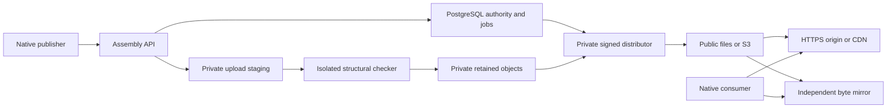

# Storage, mirrors, and operating cost

Status: published 0.7.0 client and source implementation, 8 November 2026. No official hosted V2 activation or capacity claim.

Asm keeps application logic in assembly.
Reuse the existing [assembly reader](../server/README.md), [catalog operator](../server/catalog/README.md), and [qualified-image procedure](operator-images.md).
Keep artifact bytes outside PostgreSQL.
The [hosted registry contract](hosted-registry.md) distinguishes operator imports from public publishing.

The outcome is repeatable distribution with clear costs and small hosting requirements.
This follows the foundation's resource, reuse, control, and evidence principles.
The [research record](registry-infrastructure-research.md) contains primary sources, inspected versions, prices, and alternatives.
The [infrastructure evidence](registry-infrastructure-evidence.md) and [V2 evidence](registry-v2-evidence.md) retain results, failures, and qualification limits.

## Choose the smallest topology

| Role | Components | Authority |
| --- | --- | --- |
| Byte mirror | Synchronization command, files or S3, HTTPS serving | Retain and serve selected bytes; no package ownership |
| Catalog service | Assembly reader, PostgreSQL, separate operator, retained objects, HTTPS, backups | Serve the imported catalog and perform reviewed operator changes |
| Public publishing service | Catalog service plus publisher authentication, durable tasks, isolated checks, signing, and lifecycle operations | Authorize and distribute new package releases |

Public self-service enrollment remains unimplemented.
The [assembly publisher source](../server/publisher/README.md) accepts scoped tasks through a loopback-only API.
Official hosted publication remains unprovisioned.
Private check and distribution jobs complete signed publication.
The [native V2 profile](specs/registry-v2.md) supports exact fetch, installation, and mirror selection.
The released 0.6.0 CLI retains its V1 contract.
A mirror needs no PostgreSQL, account database, publisher credential, or signing key.
Keep V2 upload staging and retained checking objects private.
Use a separate public destination for committed releases.
For a bucket-wide public domain, use a separate private bucket; a different prefix does not establish privacy.



Keep downloads independent of application health and synchronous statistics writes.
Use the existing PostgreSQL job authority.
Qualify a PostgreSQL search projection before adding another search service.
Redis, Kafka, Elasticsearch, and a new analytics service are not initial dependencies.

## Reuse ScienceHub

The read-only inventory found ingress, certificates, PostgreSQL operations, object storage, secrets synchronization, monitoring, and signed GitOps deployment.
Reuse those mechanisms with separate Asm roles, certificates, storage prefixes, and backup identities.
ClickHouse is available; it is not required for the initial observation ledger.
No existing CDN was established by the inventory.

The private repository already prepares separate internal and public Asm rollout stages.
Both were suspended during inspection.
Use that repository's reviewed Git and signed OCI/Flux process.
Do not activate it through direct cluster changes.

Recheck memory, storage, database connection budgets, and node-failure headroom before activation.
Idle CPU does not establish spare capacity.
Require an Asm-specific restore comparison before claiming recovery.

Existing MinIO is not a reason to adopt it for new production storage.
Its community repository was archived in April 2026.
Retain existing data and assess migration separately; do not share its root credentials with Asm.

## Select storage and caching

R2 Standard is a reasonable candidate for public distribution because its published Internet egress price is zero.
B2 is an alternative for storage-heavy workloads or independent backups.
External storage avoids making package delivery depend on one cluster volume.
Qualify the chosen provider's conditional writes, durability, retention, and recovery before activation.

| R2 example | Estimated monthly storage |
| --- | ---: |
| 100 GB retained continuously | $1.35 |
| 1,000 GB retained continuously | $14.85 |

These estimates apply its current 10 GB free allowance and $0.015/GB-month rate.
They exclude requests, logs, compute, backup copies, taxes, and operator time.
See the dated [price comparison](registry-infrastructure-research.md#public-list-prices) before setting a budget.

Use an artifact hostname without browser session cookies.
For R2 public delivery, use a custom domain instead of the development endpoint.
Configure explicit cache rules for artifact and snapshot paths.
Keep changing heads short-lived and avoid negative caching that hides new objects.
An ETag is a concurrency token; it is not the artifact's SHA-256.

## Operate signed V2 distribution

The publisher needs PostgreSQL, private upload storage, a private retained store, and an isolated checker runtime.
A separate distributor needs its scoped database identity, protected signing keys, and a public destination.
Reuse existing scheduling, certificate, secret, monitoring, and backup services.
No additional queue service is required.

Follow the [publisher procedure](../server/publisher/README.md) to apply both pinned migrations and configure the immutable registry identity.
Enroll an owner, issue a short-lived exact-package credential, and select the checker policy.
The private tools need Python 3.11 or later.
S3 operations additionally need the hash-locked SDK below.
Build the maintained signing adapter with the Go version in `verifier/go.mod`:

```sh
make build/asm-trust
```

Success creates `build/asm-trust` and its license notices.
Provision package-registry trust through the [registry root ceremony](registry-key-ceremony.md).
Do not use fixture keys or generate production keys in an agent workspace.
Create owned mode-`0700` work and key directories before use.
Keep the trusted root file in an owned private directory.

The [V2 image procedure](operator-images.md) packages separate publisher, operator, and credential-free checker targets.
The [publisher proxy](../deploy/publisher/README.md) preserves the assembly server's loopback boundary and supplies a separate internal probe listener.
The [Kubernetes checker procedure](kubernetes-checker.md) states its storage, admission, runtime, network, and recovery prerequisites.
Source tests and image smoke checks do not qualify those deployment boundaries.

Complete one distribution batch from retained local objects:

```sh
python3 tools/registry_distribution.py publish \
  --connection-file DISTRIBUTOR_FILE --psql PSQL_PATH \
  --worker-id WORKER_ID_32_HEX \
  --trust-root /private/asm-trust/root.json \
  --keys-dir /private/asm-trust/keys \
  --trust-tool /absolute/asm/build/asm-trust \
  --work-root /private/asm-distribution-work \
  --source-store local --source-root /private/asm-v2-retained \
  --store local --root /private/asm-v2-public --refresh
```

Replace uppercase placeholders and absolute example paths before use.
An idle job is quiet; completed work returns bounded JSON.
Use `--source-store s3` and source-prefixed options for remote retained storage.
Use `--store s3` and destination options for public S3 storage.
The same options appear in `registry_distribution.py publish --help`.
Keep source and destination roots or S3 prefixes disjoint.
Review provider access rules independently; different endpoint names can still refer to the same storage.

Schedule this command every two minutes with one active distributor instance.
The `--refresh` option renews the five-minute signed checkpoint even without package changes.
Unchanged renewals reuse the release inventory, targets, and snapshot; only timestamp signing is required.
A nearing-expiry snapshot or targets role triggers a full refresh with the required role keys.
Publication or lifecycle changes also require the applicable signing keys.
Monitor signing failures and checkpoint age; expired metadata stops new installations.

Committed payloads can transfer before signing the short-lived timestamp.
The job seals signed metadata before exposing public TUF roles or mutable heads.
Retries preserve exact signed bytes; expired attempts retain their records and reserve a higher replacement version.
No automatic garbage collector removes uncertain writes or historical releases.
Database fencing and storage comparisons are separate checks, not a shared transaction.

## Host a V2 mirror

A V2 mirror needs public-origin read access, its own writable files or S3 store, and HTTPS serving.
It needs no PostgreSQL, account service, signing adapter, or signing keys.
Install Python and the optional S3 SDK on the synchronization host.
Create an owned mode-`0700` work directory and destination.

```sh
python3 tools/registry_distribution.py sync \
  --source-store s3 --source-bucket asm-public \
  --source-endpoint https://STORAGE_ENDPOINT --source-region REGION \
  --source-profile asm-mirror-source \
  --store local --root /private/asm-v2-mirror \
  --work-root /private/asm-mirror-work
```

Success returns a bounded JSON receipt; an unchanged mirror transfers no artifact bytes.
The first successful run initializes an empty destination without a separate bootstrap flag.
Use source credentials with read access only to the public distribution prefix.
Schedule one synchronization instance every two minutes.
Keep synchronization and explicit retention audits separate:

```sh
python3 tools/registry_distribution.py verify \
  --store local --root /private/asm-v2-mirror
```

Success returns a bounded JSON audit result.
Corrupt retained bytes cause failure; restore them from a trusted copy before retrying.
Synchronization checks byte consistency; native TUF verification establishes authority and freshness.
Offline mirrors cannot learn new revocations and cannot bypass expiry in this profile.

Expose `metadata/`, `targets/`, and `blobs/sha256/` under one HTTPS base URL.
Use the [V2 nginx locations](../deploy/mirror/v2-locations.conf) with the existing static origin reference.
A bucket's HTTPS custom domain is another serving option.
Disable caching for `metadata/timestamp.json`; cache immutable digest objects independently.
Do not expose work directories, private retained objects, credentials, keys, or logs.
A public mirror need not expose its synchronization inventory.

<a id="use-the-native-v2-preview"></a>

## Use the native V2 client

Use published Asm 0.7.0 on Linux x86-64, Linux ARM64, or Apple Silicon macOS 15 or later.
Follow the [installation instructions](../README.md#install-the-command) for your supported host.
Install `curl` and `gzip` for HTTPS and source archive checks.
Project publication also needs Git 2.39.5 or later at `/usr/bin/git`.
Linux requires GNU Coreutils at `/usr/bin/sha256sum`; macOS uses `/usr/bin/shasum` for hashing.
The transport and cryptography adapter is bundled into the native assembly executable.

```sh
asm registry --help
```

Help lists the required explicit publication and trust options.
Official hosted V2 publication remains unprovisioned; use a configured registry with independently selected trust.

Alternatively, build from source on a supported host.
Install the host assembler/linker, Python, and the Go version in `verifier/go.mod` before building.

```sh
make registry-cli
build/asm-registry-v2 registry --help
```

Success creates `build/asm-registry-v2` with the same command family.
Use that path instead of `asm` in the commands below when selecting this source build.
Ordinary `make` and published 0.7.0 CLIs include V2 commands.
`make REGISTRY_V2=0` selects the explicit V1-only source profile.
Project publication reads committed Git objects and prepares the archive and canonical manifest in assembly.
It ignores dirty and untracked working files.
It does not build, test, or execute the project.
Use the package's actual license identifier and enrolled owner identity.
The committed `asm.toml` supplies the version.

```sh
asm registry publish \
  --project /absolute/project-repository \
  --name owner/package --owner-id OWNER_ID_32_HEX \
  --summary "The package purpose." --license SPDX_IDENTIFIER \
  --source-target TARGET \
  --credential-file /private/asm/publisher.token \
  --api https://api.registry.example \
  --idempotency-key REQUEST_ID_32_HEX --json
```

Replace uppercase placeholders before use.
Select a declared supported target, such as `x86_64-linux`, with `--source-target`.
Repeat that option for additional source targets, up to six.
An executable selection uses `--executable TARGET /absolute/prepared-program`.
Publication snapshots that file without building or executing it.
Every publication retains the committed source archive, including executable-only selections.

Use the repository root for `--project`.
For a monorepo, add `--source-path packages/example` to select its committed project subtree.
The source manifest, required files, and version must exist in that subtree.
Uncommitted version or source edits do not enter the release.
Project mode retains dependency options and feature groups from the committed manifest.
It refuses malformed declarations and a committed consumer `asm.lock`.
Known sensitive filenames, links, submodules, path conflicts, and exceeded bounds fail before credentials or HTTP.
This filename policy cannot detect arbitrary secrets committed under ordinary names.

Use `--commit FULL_COMMIT` to select an exact retained SHA-1 or SHA-256 commit.
Otherwise, the command resolves HEAD once.
After an uncertain result, preserve the original commit, metadata arguments, executable bytes, toolchain, and request identity.
Repeat with `--commit` to avoid selecting a newer HEAD.
Same-source retries with the same compression tool produce the same prepared bytes.
Different compressor versions can produce different compressed bytes; a changed request cannot replace its earlier task or published version.
Git helpers, filters, hooks, remote fetches, and build commands receive no publication credential.

An optional `--repository https://entire.com/example/package` records a descriptive source locator.
It does not fetch that repository or verify its publisher identity.
GitHub, Entire, GitLab, Codeberg, and local repositories use the same workflow.

Prepared input remains supported:

```sh
asm registry publish \
  --manifest /private/package/manifest.json \
  --objects-dir /private/package/objects \
  --credential-file /private/asm/publisher.token \
  --api https://api.registry.example \
  --idempotency-key REQUEST_ID_32_HEX --json
```

Do not combine prepared inputs with `--project`.
Both modes return a schema-2 task response, not immediate publication.
The client skips object receipts already confirmed by the server.
Read the resulting task with `registry task TASK_ID --credential-file FILE --api HTTPS_BASE`.
Only `published` exposes a usable signed release.

Get the initial root and registry identity through an independent trusted channel.
Keep the root file and persistent trust directory under an owned private directory.
Install an exact compatible executable through explicitly selected mirrors:

```sh
asm registry install owner/name@1.0.0 \
  --registry-id REGISTRY_ID_32_HEX \
  --root /private/asm-trust/root.json --state /private/asm-trust/client-state \
  --mirror https://mirror-one.example/asm --mirror https://mirror-two.example/asm \
  --target x86_64-linux --kind executable --output /absolute/bin/example
```

Success is quiet and does not execute the program.
Run the installed program deliberately when you choose.
Use `registry fetch` to expose checked source or executable bytes without installation.
Use `--ca /private/asm-trust/ca.pem` when private HTTPS requires an explicit certificate authority.
A failed mirror can select the next mirror; authority and retained rollback state stay the same.
Invalid signatures, stale metadata, revocation, corruption, and unrelated existing destinations fail without replacing installed bytes.
V2 installation inventories require a V2-enabled client; V1-only clients cannot manage those inventories.
V1 upgrade refuses V2 origin receipts; V2 version changes require another explicit exact selection.

GitHub, Entire, GitLab, Codeberg, and local projects use the same publication contract.
The optional source locator is descriptive; publication does not fetch it or authenticate the source host.
Asm's enrolled owner and scoped credential authorize publication.
CI identity integration remains optional future work.

## Resolve and restore V2 dependencies

Use the native V2 client described above on a supported host.
Keep the transport and source-archive prerequisites for registry commands.
Install build tools before compiling assembly.
Project publication also requires Git.
Obtain the initial root and registry identity independently of artifact mirrors.
No publisher credential or account is required for dependency resolution.

Add source dependencies to the consumer's `asm.toml`:

```toml
[dependencies]
"owner/math" = "^1.2.0"
"owner/text" = ">=2.0.0,<3.0.0"
```

Keep the existing package and build or target tables.
Requirements accept exact numeric versions, `*`, caret, tilde, and at most eight comma-separated comparisons.
Use full `major.minor.patch` versions without whitespace inside requirements.
Prereleases and dependencies from another registry are unsupported.
Each component must fit the documented numeric version limit.

Declare optional dependencies and feature groups when needed:

```toml
[dependencies]
"owner/math" = "^1.2.0"
"owner/vector" = { version = "~2.0.0", optional = true, default-features = false, features = ["portable"] }

[features]
default = ["vectors"]
vectors = ["dep:owner/vector", "owner/math/checked"]
```

A feature groups dependency selections; it does not define assembly symbols or import source files.
A dormant optional edge contributes no version constraint, default, or child feature request.
Requests from active paths combine.
A disabled default on one edge cannot remove a default enabled by another edge.
Unknown local references, duplicate members, and local feature cycles fail validation.
The [feature contract](specs/registry-v2.md#feature-activation) defines names, activation, and bounds.

Resolve the complete graph for one declared target:

```sh
asm registry resolve --project /absolute/project \
  --registry-id REGISTRY_ID_32_HEX \
  --root /private/asm-trust/root.json --state /private/asm-trust/client-state \
  --mirror https://mirror-one.example/asm --mirror https://mirror-two.example/asm \
  --target x86_64-linux
```

Success is quiet and creates a version-four `asm.lock` atomically.
Add `--no-default-features` to disable the root's implicit default group.
Add `--features vectors` to request that root feature explicitly.
Use only names declared in the root project; an unknown name fails before a network request.
Resolve reads signed metadata without downloading artifacts or executing package code.
An explicit resolve can select newer permitted versions.
Keep the lock with the consumer project when repeatable selections are required.
Preserve a legacy lock separately before adopting this V2 workflow.
Resolve refuses a lock bound to another authority or target.
It also refuses changed package identities and altered bindings for an already locked version.
Preserve that lock when investigating a changed registry view.

Restore its exact packages:

```sh
asm registry sync --project /absolute/project \
  --registry-id REGISTRY_ID_32_HEX \
  --root /private/asm-trust/root.json --state /private/asm-trust/client-state \
  --mirror https://mirror-one.example/asm --mirror https://mirror-two.example/asm \
  --target x86_64-linux
```

Success is quiet and restores checked source trees under `.asm/packages/OWNER/NAME/VERSION/TARGET`.
Sync retains exact metadata envelopes under `.asm/metadata/ENVELOPE_SHA256.json`.
Sync uses the lock's recorded feature choices; it does not accept feature selection options.
Repeated sync reuses checked digest archives without another artifact transfer.
Sync authenticates exact metadata and checks every selected release against fresh lifecycle policy.
It never replaces the lock or selects newer versions.
Use explicit source imports through the existing package include directory.
Sync does not build or execute a package.

Run `asm build --locked` with the full client from the consumer directory.
The build checks the root manifest, feature closure, complete graph, cached metadata, archives, declarations, and extracted files.
Run sync again when required cached metadata is missing or damaged.
It does not refresh remote lifecycle policy or establish current registry authentication.
Run sync when current registry policy is required.
Local builds remain ordinary trusted project builds, not isolated execution environments.

The first graph profile selects one version per package for one explicit target.
It supports consistent dependency cycles and records every edge.
It reads at most 256 reached candidate versions and 64 dependencies per release.
The solver stops after 100,000 operations and reports exhaustion separately from incompatible constraints.
Discovery fetches metadata only when an active solver branch requires a package name.
It can read unused versions of that name; it does not fetch their artifacts.
This bounded V2 profile does not establish global resolver capacity.

Mirrors still need only storage synchronization and HTTPS serving.
Resolution adds no database, resolver service, publisher secret, or signing key to a mirror.
The [contract](specs/registry-v2.md) and [feature evidence](v2-feature-evidence.md) state the implementation and qualification limits.

## Collect V2 download observations

Use the static nginx reference with the V2 include for normalized private logs.
Give nginx an owned private process prefix for its temporary directories.
Mount the public mirror read-only and keep logs outside public storage.
The supplied configuration excludes raw queries, IP addresses, cookies, user-agent strings, and referrers.

V2 clients add public registry, package, release, target, and kind identifiers to the ordinary digest GET.
The physical object key remains unchanged.
There is no additional measurement request or visitor identity.
The log exporter writes only a validated canonical selection URI.
Bare digest requests, malformed tags, unreported mirrors, and unreported cache hits remain outside these observations.

Rotate the log before importing it.
Choose one stable source name for that delivery layer and a stable identity for each immutable log batch.
Keep the ledger outside every public directory.
Use the local mirror's immutable release metadata to bind names and sizes to package and release identities.
The importer reads no package blobs, source archive, signing key, or database credential.

```sh
python3 tools/registry_log_import.py \
  --distribution-root /private/asm-v2-mirror --registry-id REGISTRY_ID_32_HEX \
  import --state /private/asm-stats/v2.sqlite3 --source mirror-main \
  --batch BATCH_ID --start START_UTC --end END_UTC \
  --log /private/asm-logs/downloads-v2.jsonl

python3 tools/registry_log_import.py \
  --distribution-root /private/asm-v2-mirror --registry-id REGISTRY_ID_32_HEX \
  snapshot --state /private/asm-stats/v2.sqlite3 --source mirror-main
```

Use UTC interval values such as `2026-11-08T00:00:00Z`.
Import success is quiet; an exact batch replay changes no counts.
Snapshot success prints one bounded schema-2 JSON object.
Publish that output through static storage only after a successful command, using atomic replacement through the existing deployment procedure.
The existing website's V1 catalog and observations remain a separate collection.

Counts are keyed by immutable package and release identities.
The snapshot supplies their display names and versions separately.
Before a real reporting cutoff, counts remain null.
An imported empty batch supplies observed zero only for that source and interval.
All observations remain incomplete lower bounds with explicit cutoff, stale state, gaps, and rolling and retained scopes.
Completed sender responses do not establish verification, installation, unique people, or safety.

The importer counts complete public HTTP 200 GET responses with the declared full byte length.
It excludes HEAD, ranges, redirects, conditional responses, failures, interrupted transfers, and classified bot or internal traffic.
Well-formed tags with unknown or mismatched selections advance only the separate unattributed-request counters.
Those diagnostic counters include requests across methods and statuses; they are not verified-download counts.
Such tags cannot credit a package or stop valid observations in the batch.
Malformed event files, changed immutable metadata, conflicting request identities, and registry confusion fail before writes.

Select edge viewer observations or origin-miss observations for the same delivery path.
Do not add both layers for the same requests.
Keep default cache keys unless a reviewed rule safely excludes selection tags on immutable public blobs.
A query-independent key must not admit response-override cache poisoning.
Qualify ordinary GET-with-query behavior on the selected S3-compatible provider before activation.
Raw provider logs can contain personal data; no cloud-log adapter is enabled by this reference.
The [observation contract](specs/registry-v2.md#v2-delivery-observations) records the limits and primary protocol references.

## Build the V2 website

Install Node.js 18 or later for the build-time JavaScript minifier.
Use an owned local copy of the public V2 mirror for the static build.
Keep the private log ledger outside that mirror and the website output.
Select the registry identity and HTTPS mirror bases explicitly.

```sh
python3 tools/build_site.py \
  --v2-distribution-root /private/asm-v2-mirror \
  --v2-registry-id REGISTRY_ID_32_HEX \
  --v2-mirror https://mirror.example/asm \
  --origin-log-state /private/asm-stats/v2.sqlite3 \
  --origin-log-source mirror-main \
  --output /private/asm-sites/next
```

Create the output's parent directory before the command.
Choose a new output directory for each build.
Success reports the number of release records and atomically creates the complete directory.
A failed build leaves an existing destination unchanged.
Omit `--origin-log-state` when reporting is unavailable; the generated counts remain unknown.
Repeat `--v2-mirror` for up to three ordered mirrors.
Use the same source names as the log importer.

Serve this output through the existing static web server or object-storage deployment procedure.
No website application service, database connection, signing key, or publisher credential is required.
The default build reads metadata and the ledger, without downloading artifact blobs.
Add `--verify-artifacts` to check retained artifact bytes and enable their direct download links.
Native fetch commands remain available without that extra scan and independently verify downloaded bytes.

Rebuild after a completed publication, lifecycle change, or log import.
Use the existing job scheduler; no new always-running worker is needed.
Timestamp-only renewal does not require a site rebuild.
The website shows its distribution revisions and observation cutoff.
It can lag the registry; native commands still check current signed lifecycle policy.
Unreported time remains a gap rather than zero activity.

Use published Asm 0.7.0 for the package pages' V2 commands.
The [source build](#use-the-native-v2-client) remains an alternative.
Asm 0.6.0 does not provide that command family.
Obtain the initial trust root and registry identity independently before using a copied command.
Replace its root, state, and output placeholders with protected absolute paths.
Fetch does not install or execute package code.

Use an isolated preview or on-premises origin for this output.
The default official Pages build, checked installer, self-update trust, and V1 feeds remain unchanged.
Do not replace the official root until deployment preserves and qualifies those compatibility routes.
The [website projection contract](specs/registry-v2.md#static-website-projection) defines the scope.

## Retain the V1 compatibility distribution

The following commands serve the released V1 contract.
They do not select the signed V2 profile.

### Publish a compatibility snapshot

Run the private operator commands on Linux or macOS.
Use Python 3.11 or later from the repository root.
Local filesystem storage requires only the standard library.
Install the locked SDK only for S3 operations:

```sh
python3 -m venv .venv
.venv/bin/python -m pip install --require-hashes -r requirements-storage.txt
```

Use an exact accepted Git commit and checked local release assets.
The operator reader ignores working-tree changes and rejects invalid Git objects.
The former registry pull-request intake remains retired.

```sh
python3 tools/registry_mirror.py publish \
  --repository . --commit FULL_ACCEPTED_COMMIT \
  --artifacts-dir /private/asm-assets \
  --store local --root /private/asm-origin --initialize
```

The command returns the snapshot SHA-256.
Use release filenames or digest names in the artifact directory.
Later publications omit `--initialize`.
An exact retry retains the same snapshot.

For S3, replace the destination options:

```sh
.venv/bin/python tools/registry_mirror.py publish \
  --repository . --commit FULL_ACCEPTED_COMMIT \
  --artifacts-dir /private/asm-assets --store s3 \
  --bucket asm-artifacts --endpoint https://STORAGE_ENDPOINT \
  --region REGION --profile asm-publisher --initialize
```

Replace uppercase placeholders before use.
Keep credentials in a scoped SDK profile or deployment credential provider.
Never put credentials in command arguments or a public prefix.
Use separate read-only credentials for mirror sources.
An S3 mirror destination needs its own scoped write credential.

The tool verifies every artifact and conditionally creates digest-keyed blobs.
It writes immutable snapshots and advances `head.json` last with a conditional update.
Stale writers fail without replacing the winning head.
Failed work can leave unreferenced immutable objects; no automatic deletion is supplied.
Published versions, licenses, source identities, targets, and original URLs remain unchanged.

Snapshots contain the four exact canonical feeds: Linux, macOS compatibility, full-target TSV, and JSON.
Their metadata evidence remains `not-run` for checks without a retained catalog evidence record.
Storage verification does not become publisher authentication or formal proof.

These tools retain the bounded V1 compatibility catalog.
Limits are 1 MiB per snapshot manifest, 4,096 retained artifact selections, 4 MiB per JSON export, and 64 MiB per artifact.
History walks permit at most 4,096 snapshots.
Publication and explicit verification inspect retained artifacts; they are not the proposed per-package global publication path.
The signed V2 profile above has separate trust and compatibility bounds.
Neither profile establishes global capacity.

### Gate a catalog import on retained bytes

Use the existing [operator procedure](../server/catalog/README.md#operator-procedure) to migrate, grant, bind namespaces, and review a plan.
Keep database credentials out of the storage synchronization job.
Use the same accepted commit for storage and the reviewed import plan.

Synchronize an S3 origin into a private local store when necessary.
Then select that store for the import:

```sh
python3 tools/registry_admin.py \
  --connection-file OPERATOR_FILE --psql PSQL_PATH import \
  --repository . --commit FULL_ACCEPTED_COMMIT \
  --expected-revision REVISION --plan-sha256 PLAN_DIGEST \
  --distribution-root /private/asm-origin
```

This option checks the exact commit, canonical records, artifact bytes, and snapshot head before opening database credentials.
The existing transaction then commits catalog records and all exports atomically.
Storage and database revision numbers describe different systems; never equate them.
A database failure retains the completed storage snapshot for an idempotent retry.
Plain operator import remains metadata-only; it does not imply artifact validation.

The assembly reader still receives only its read credential.
Do not expose these operator commands through HTTP.
The [existing container contracts](server-images.md) define non-root operation, source identity, certificates, and qualification.

### Run a V1 compatibility mirror

```sh
python3 tools/registry_mirror.py sync \
  --source-store local --source-root /private/asm-origin \
  --store local --root /private/asm-mirror --initialize
```

Use source-prefixed S3 options for a remote origin.
The destination can also use S3.
Schedule repeated synchronization without `--initialize` after its first success.
It rejects corrupt objects, version rewrites, rollback, and unrelated histories.
It retains historical artifacts, including yanked releases.

An unchanged head requires only metadata checks; it does not transfer every artifact again.
An advancing head reads existing destination bytes and fetches only missing digests.
Routine unchanged synchronization is not a retention audit.
Use explicit verification to inspect current exports and all retained artifact selections:

```sh
python3 tools/registry_mirror.py verify --store local --root /private/asm-mirror
```

This reads the selected artifacts and checks the four canonical exports.
Schedule that audit according to your storage risk and read budget.
It refuses corruption instead of overwriting retained bytes.
Use `sync --check-existing` to check unchanged mirrors and restore missing objects from the selected origin.
Corrupt retained bytes still require restoration from a trusted backup; synchronization will not replace them.

Use the [static origin reference](../deploy/mirror/README.md) for exact selection routes, ranges, and private logs.
A bucket with public HTTPS or a CDN can serve retained objects without an application database.
TLS, serving permissions, log rotation, and scheduling remain operator responsibilities.

Snapshot hashes establish transport integrity, not publisher identity or metadata freshness.
Released V1 clients retain GitHub artifact URLs; they do not automatically select an S3 mirror.
Use the explicit V2 client above for authenticated mirror selection.
Do not solve air-gap expiry failures by weakening verification.

## Collect observations asynchronously

Use immutable rotated logs from the exact artifact routes.
The [log importer](../deploy/mirror/README.md#import-delivery-observations) defines event fields, bounds, and retry behavior.
It retains no IP address, cookie, user-agent string, referrer, or query string.
Source-scoped request identities prevent duplicate counting across replayed batches.

Build the current website from the selected ledger:

```sh
python3 tools/build_site.py --output /private/asm-site \
  --origin-log-state /private/asm-stats/events.sqlite3 \
  --origin-log-source origin-main
```

This selects the origin ledger instead of the local live-development ledger.
It does not add their totals together.
Missing reports remain unknown; origin observations remain lower bounds.
This website integration selects V1 observations.
Use the separate registry-scoped V2 snapshot above for tagged V2 downloads.
CDN hits require a separately qualified edge-log adapter.
Unreported mirror traffic remains unknown.
Completed sender responses do not establish installation or unique people.
The statistics JSON retains configured source names, reporting profile, request deduplication rule, and observation cutoff.

The initial private ledger has explicit storage and event limits.
Archive its evidence before those bounds; it refuses further imports instead of deleting history.
Statistics failure does not affect artifact delivery.
Move aggregate processing to existing PostgreSQL or ClickHouse capacity only with measured demand and a qualified migration.

## Activation and recovery

Before activation, test real provider conditional writes, stale heads, interrupted transfers, scoped credentials, and restore.
Restore PostgreSQL, retained objects, configuration, and required trust state into isolated resources.
Compare namespace bindings, releases, digests, lifecycle history, and all canonical exports.
Retain failed results as well as successful comparisons.

Qualify the local publisher's authorization, uploads, and isolated checks in the selected deployment.
Production signing custody, deployed lifecycle delivery, and real provider/client verification remain required.
The [hosted registry requirements](hosted-registry.md) and [acceptance gates](architecture-gates.md) remain authoritative.
Neither these tools nor a healthy pod establish the complete publishing service.
